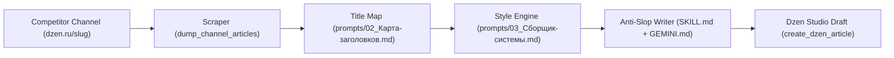

# Yandex Dzen Autopilot (`dzen-mcp`)

[](https://www.python.org/)
[](https://modelcontextprotocol.io/)
[](https://playwright.dev/)
[](LICENSE)

**Agent Skill + Local MCP Server for end-to-end Yandex Dzen content automation: competitor scraping, title pattern reverse-engineering, anti-slop editorial style extraction, and rich-formatted publishing directly to Dzen Studio.**

---

## English Overview (for Agensi.io & International Users)

`yandex-dzen-autopilot` (`dzen-mcp`) turns any MCP-compatible AI agent (Claude Code, Cursor, Antigravity, Windsurf, VS Code Copilot) into a full-stack Yandex Dzen editorial pipeline:

- **Competitor Intelligence (`dump_channel_articles`)**: Scrapes any public Dzen channel's chronological `article` feed in an isolated headless Chromium instance (never touching your logged-in profile) and exports `Title = views` rankings.
- **Title Map & Style Engine (`prompts/`)**: Two battle-tested editorial prompts (`02_Карта-заголовков.md` and `03_Сборщик-системы.md`) reverse-engineer competitor hooks, rhythm metrics, and niche vocabulary into a 3-file editorial system (`ИНСТРУКЦИЯ.md`, `СТИЛЬ.md`, `СТРУКТУРА.md`).
- **Anti-Slop Native Publishing (`create_dzen_article` / `create_dzen_post`)**: Writes directly into Dzen Studio's Draft.js / Quill editors with real `H2` headings, blockquotes, bullet lists, bold/italic formatting, optional local image upload, and verified autosave confirmation (`Сохранено`).
- **Session Persistence & Safety (`login_dzen`)**: Uses a local `./dzen_profile` with anti-detection flags (`--disable-blink-features=AutomationControlled`) and defaults to saving drafts (`publish=False`).

---

## Архитектура пайплайна



---

## Quick Start (2 минуты)

### Windows
```bat
git clone https://github.com/Strenchnow/MCP-dzen.git
cd MCP-dzen
install.bat
```

### macOS / Linux
```bash
git clone https://github.com/Strenchnow/MCP-dzen.git
cd MCP-dzen
chmod +x install.sh
./install.sh
```

Скрипт сам создаст `.venv`, установит `mcp[cli]` и `playwright`, скачает Chromium, выведет готовый JSON-блок для вашего `mcp_config.json` и сохранит его в `mcp_config_snippet.json`.

### Подключение к MCP-клиенту
1. Скопируйте содержимое `mcp_config_snippet.json` в ваш конфиг:
   - Проектный: `.agents/mcp_config.json`
   - Глобальный: `~/.gemini/config/mcp_config.json` (или конфиг Claude Code / Cursor / Windsurf).
2. Нажмите **Refresh** (или перезапустите MCP-сервер в настройках клиента).
3. Выполните первичный вход: попросите агента вызвать `login_dzen`.

---

## MCP-инструменты

| Инструмент | Параметры | Описание | Пример промпта |
|---|---|---|---|
| `login_dzen` | `timeout_seconds: int = 150` | Открывает Chromium (`headless=False`) для входа через Яндекс ID / VK ID, проверяет доступ к Студии и сохраняет сессию в `./dzen_profile`. | «Вызови `login_dzen`, чтобы я вошёл в Дзен-студию.» |
| `dump_channel_articles` | `slug: str`, `days: int = 60`, `output_dir: str \| None = None` | В чистом изолированном браузере выгружает статьи и просмотры чужого канала (`worldlord` или `id/...`) за N дней в `./exports/` и возвращает топ-5. | «Выгрузи статьи канала `worldlord` за 30 дней и собери карту заголовков.» |
| `create_dzen_article` | `title: str`, `content: str`, `image_path: str \| None = None`, `publish: bool = False`, `headless: bool = True` | Создаёт статью в Дзен-студии с вёрсткой (`## `, `> `, `- `, `**жирный**`, `*курсив*`), ждёт статуса «Сохранено» и сохраняет черновик или публикует. | «Напиши статью по нашему стилю и сохрани в черновики без картинок.» |
| `create_dzen_post` | `text: str`, `image_paths: list[str] \| None = None`, `publish: bool = False`, `headless: bool = True` | Создаёт короткий пост в Дзен-студии, прикрепляет локальные фото (если переданы) и сохраняет черновик или публикует. | «Сделай короткий пост-анонс для Дзена и сохрани как черновик.» |

---

## Регламент качества (Anti-Slop & Dzen Rules)

Проект поставляется со стандартизированным скиллом [SKILL.md](SKILL.md) и правилами [GEMINI.md](GEMINI.md):
- **Никаких ИИ-картинок:** обложки не генерируются (Дзен пессимизирует ИИ-иллюстрации); `image_path` используется только для локальных файлов пользователя.
- **Типографика Дзена:** длинное тире `—` запрещено, кавычки только «ёлочки», короткие абзацы (1–2 предложения), живой ритм без канцелярита («однако», «стоит отметить», «является», «в современном мире»).
- **Безопасный режим:** все публикации по умолчанию уходят в черновики (`publish=False`).

---

## Troubleshooting

- **Ошибка блокировки профиля (`Browser profile ... is currently locked` / `ProcessSingleton`)**
  Профиль `./dzen_profile` может использоваться только одним окном Chromium одновременно. Закройте открытое окно браузера (например, после `login_dzen` или отладочного запуска с `headless=False`) и повторите вызов.
- **Изменения в `server.py` или `selectors.py` не применяются / не видно новый инструмент**
  Нажмите кнопку **Refresh** рядом с `dzen-mcp` в настройках MCP-клиента (или перезапустите IDE), чтобы перезапустить процесс Python-сервера.
- **Ошибка `Could not find element '<group>.<key>'`**
  Яндекс Дзен обновил вёрстку Студии. Все CSS/XPath-селекторы вынесены в [dzen_mcp/selectors.py](dzen_mcp/selectors.py) — достаточно обновить нужный массив селекторов без правки логики `server.py`.
- **Выгрузка `dump_channel_articles` вернула ошибку капчи/редиректа**
  Подождите 1–2 минуты и повторите запрос (между страницами уже встроена пауза 300 мс).

## Лицензия

Распространяется под лицензией [MIT](LICENSE).
